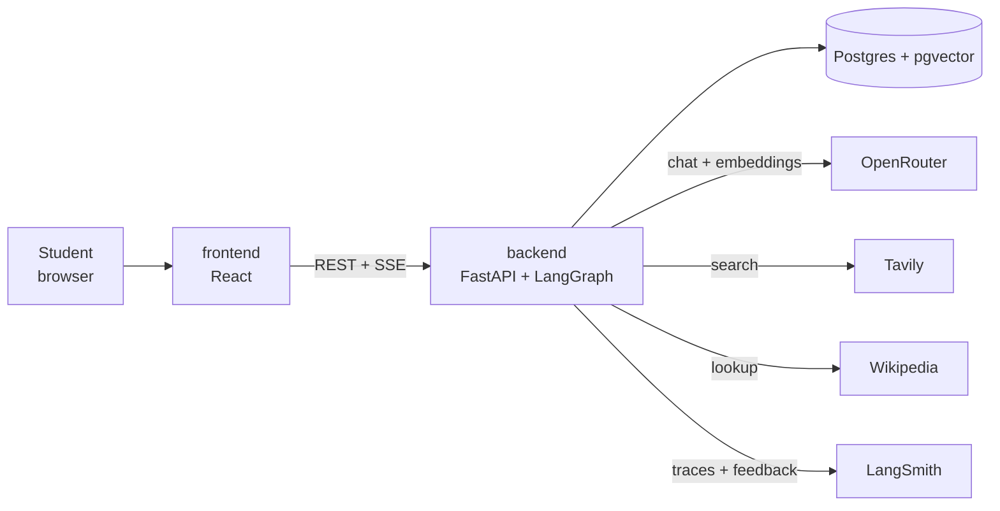
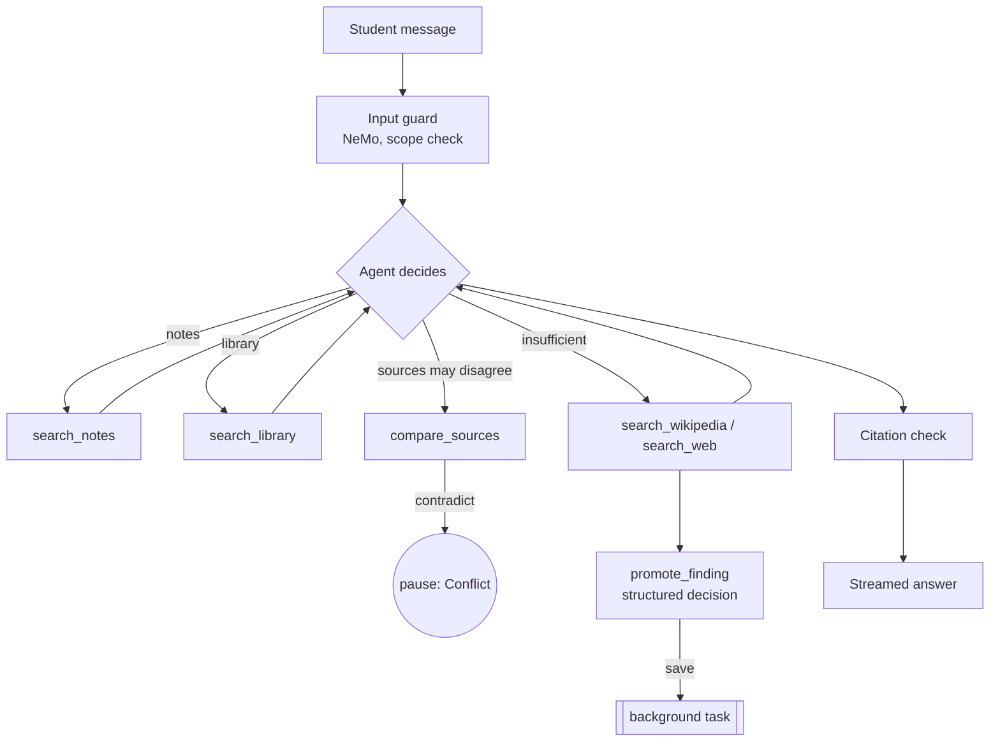
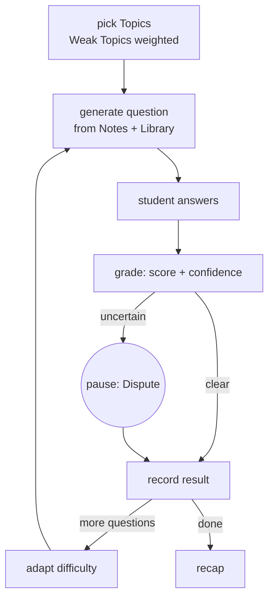
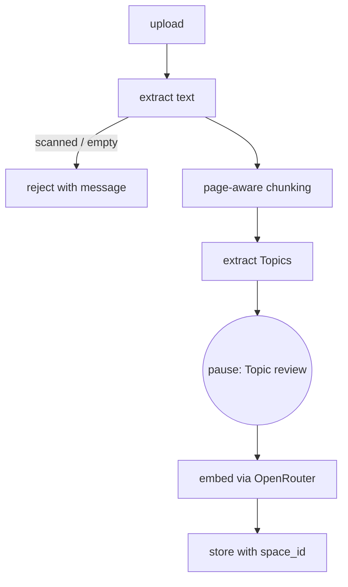

# Jimmy: Architecture

How the system is built. For what it does and why, see [design.md](./design.md). For the vocabulary see [GLOSSARY.md](./GLOSSARY.md), and for the domain model see [domain.md](./domain.md). Hard-to-reverse decisions are in [adr/](./adr/).

## 1. System context

Jimmy is a local-only web app for one Student at a time (Students sign up and sign in with an email and a password; the session is a signed JWT in an httpOnly cookie). It calls out to four external services.



## 2. Stack

| Layer | Choice |
|---|---|
| Backend | Python, FastAPI, SQLAlchemy, Alembic, uv, Ruff, pytest |
| Agents | LangChain `create_agent`, LangGraph, LangSmith (EU endpoint) |
| Models | OpenRouter. `TUTOR_MODEL`, `BACKGROUND_MODEL`, `EMBEDDING_MODEL` (default `openai/text-embedding-3-small`) set by env |
| Database | One Postgres with pgvector (app data, vectors, LangGraph checkpoints) |
| Frontend | React, React Router, shadcn |
| Guardrails | A prompted classifier on a cheap allowed model (`GUARD_MODEL`) for Student input, scope and injection scans of Notes and web text, plus a list of known injection phrases; see ADR 0003 |
| Evaluation | Ragas plus custom checks |

## 3. Runtime

`docker compose up -d` with one `.env` starts three services: `db` (pgvector image), `backend` and `frontend`. Local only, never deployed.

**Assumptions to confirm** (not discussed explicitly): the backend container runs `alembic upgrade head` on start; seeding demo data is a separate command; the frontend container runs the Vite dev server with a bind mount for hot reload.

Configuration comes from `.env`: OpenRouter key, Tavily key, LangSmith key and endpoint, the three model ids, database URL, and the grading and guardrail thresholds.

## 4. Agent architecture: three LangGraph pieces

### 4.1 Tutor chat (`create_agent`, free-form ReAct)



Tools, all toggleable: `search_notes`, `search_library`, `search_wikipedia`, `search_web`, `compare_sources`, `promote_finding`, `record_quiz_result`, `save_flashcards`.

Middleware: input guard; text in Notes and Findings treated as data, never instructions; iteration cap of 8 and doom-loop stop at 3 identical calls; Citation check on every answer; tool policy and logging; summarisation for long chats.

### 4.2 Study Session (`StateGraph`, Quiz and Test)



A Quiz shows feedback after each answer. A Test withholds results until the recap.

### 4.3 Ingestion (`StateGraph`)



### 4.4 State and context

State: messages plus domain state (active Study Space, current Topic, difficulty, score, Findings gathered in this conversation). Context (immutable): `student_id`, the Study Space id and the enabled tools.

## 5. Human-in-the-loop over HTTP

Every pause uses LangGraph `interrupt()`, which saves the run to the Postgres checkpointer and stops. FastAPI streams the run over SSE with typed events: `token`, `tool_call`, `citation`, `cost`, `interrupt`, `done`. The React app shows the pause (Conflict, Dispute, Flashcard review, Topic review or delete confirmation) and answers with `POST /threads/{id}/resume`, which continues the run from the checkpoint. Background Promotion progress is delivered as a toast event.

## 6. API surface (resources, not final paths)

Full contract: [api.md](./api.md).

Study Spaces; documents and upload status; Topics; threads (create, stream a message, resume); study sessions (start, answer, resume); Flashcards and the review queue; Learned Material (list, approve, delete); Weak Topics (list, clear); Profile facts; feedback; settings (models, temperature, max tokens, tool toggles); usage and cost. Every Study Space resource is addressed under its `space_id`.

## 7. Data model (Postgres)

Full schema, constraints and migration rules: [database.md](./database.md).

Tables: `spaces`, `documents`, `chunks` (with `space_id`, `source_type` in notes / library / learned, document title, author, page or section, topic, embedding model and dimensions), `topics`, `quiz_attempts`, `weak_topics`, `flashcards`, `learned_material`, `profile` facts, `conflict_decisions`, `disputes`, `feedback`, `jobs` (background Promotion), plus LangGraph checkpoint tables. Managed with SQLAlchemy and Alembic. The embedding model is locked once chunks exist, because changing it means re-embedding everything.

Isolation: every chunk carries `space_id`, and one retrieval function that requires `space_id` is the only code that queries chunks (ADR 0001). Deleting a Study Space cascades to everything it owns.

## 8. Observability and cost

LangSmith traces every run. A 👍/👎 on an answer is stored with the trace id and sent to LangSmith as feedback. Tokens and estimated cost are calculated per answer from model pricing and shown in the UI.

## 9. Test seams

Unit tests only, for critical backend logic, with a fake model. No integration tests, no frontend tests; real-model checks are manual. Seams, each a pure function or small module: the Weak Topic rule, the Promotion gate, the Citation check, cost calculation, chunking and citation metadata, grading and Dispute routing, and the retrieval function's `space_id` guard (tested by checking that it refuses to run without `space_id` and always builds the query with it). Evaluation scripts live outside the test run.

## 10. Planned repository layout

```
jimmy/
├── backend/            FastAPI app, graphs, tools, middleware, migrations, tests
├── frontend/           React app
├── eval/               golden set, Ragas run, report
├── data/seed/          demo data download target (not committed)
├── docs/
├── docker-compose.yml
├── .env.example
└── LICENSE
```

**Code is organised by feature, not by technical layer**, on both sides. A feature owns everything it needs; shared code stays small and has no knowledge of any feature.

```
backend/app/
├── main.py, config.py, db.py, errors.py, tracing.py   # app-wide
├── students/       # models.py, schemas.py, router.py, dependencies.py
└── spaces/         # models.py, schemas.py, router.py (one package per feature)

frontend/src/
├── main.tsx, App.tsx
├── components/     # app shell (Providers, AppRoutes, Layout, Header, SpaceTabs, Logo, Toaster), menus (DropdownMenu, MenuSurface) and ui/ (shadcn, restyled to the design)
├── lib/            # http client, utils, schemas/ (feature-agnostic)
└── features/
    ├── auth/
    │   ├── schemas/     # Zod schemas and inferred types (Student, sign-in, sign-up)
    │   ├── queries/     # requests, useMe, useSignIn, useSignUp, useSignOut
    │   ├── hooks/       # useSignedInStudent
    │   ├── AuthPage.tsx # Sign in / Sign up on one screen
    │   ├── components/  # forms, RequireAuth, UserMenu
    │   └── lib/         # password strength, form errors
    ├── onboarding/
    │   ├── schemas/     # Zod schemas (request, response, years, goals, styles)
    │   ├── queries/     # POST /onboarding
    │   ├── OnboardingPage.tsx  # five steps, then the finish screen
    │   ├── components/  # one component per step, RequireOnboarded
    │   └── lib/         # form state helpers, subject suggestions
    ├── spaces/
    │   ├── schemas/     # Zod schemas and inferred types (Space, Accent)
    │   ├── queries/     # requests, keys, useSpaces, useCreateSpace, ...
    │   ├── SpacesPage.tsx  # the feature's page
    │   ├── components/  # dialogs used by the page
    │   └── lib/         # accents
    └── health/          # schemas/, queries/ (useHealth), components/
```

Inside a feature, use only the sub-folders it needs: `schemas/`, `queries/`, `hooks/`, `state/`, `components/`, `lib/`. In this pure React app a feature is normally a page, so its page component sits at the feature root (no `pages/` folder). A dialog is not a feature of its own unless it is complex enough to need its own api, hooks and state, and a tab is sometimes a feature; otherwise dialogs and tabs live in the `components/` of the page that uses them. `schemas/` holds the Zod schemas and the types inferred from them (no other file declares an API type by hand); `queries/` holds everything that talks to the server (request functions, query keys and the React Query hooks); `hooks/` is for other hooks; `state/` is for client state.

A new feature gets its own package or folder. A feature may import another feature (Spaces uses the signed-in Student) but `lib/` and `db.py` never import a feature. Alembic's `env.py` imports each feature's models so their tables are registered.
