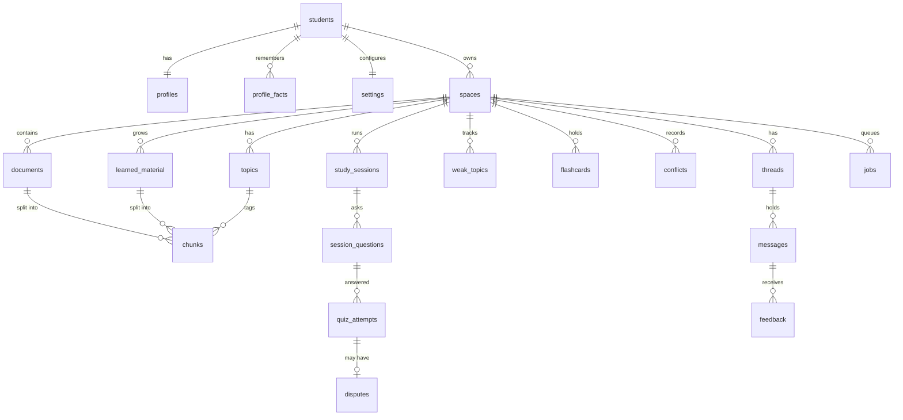

# Jimmy: Database

Postgres schema, conventions and migrations. See [architecture.md](./architecture.md) for how the database fits in, [domain.md](./domain.md) for the rules the tables must support, and [api.md](./api.md) for how the data is exposed.

**Status:** draft. Table and column names are proposals (marked *proposed*) until the first migration is written. The decisions that are firm come from the design: one Postgres with pgvector, a mandatory `space_id` on chunks (ADR 0001), and Learned Material kept apart from trusted Sources (ADR 0002).

## 1. Setup

- **Postgres** with the **pgvector** extension, run from the `pgvector/pgvector` image in Docker Compose, data on a named volume.
- **SQLAlchemy 2** for models and queries, **Alembic** for migrations.
- **Two owners of tables:** Alembic owns the application tables below. The LangGraph Postgres checkpointer creates and maintains its own checkpoint tables. Alembic must be configured to ignore them, otherwise autogenerate will try to drop them.

## 2. Conventions

- **Primary keys:** UUIDs generated by the database.
- **Timestamps:** `created_at` on every table, `updated_at` where rows change, all `timestamptz` in UTC.
- **Enumerations:** plain text columns with `CHECK` constraints, not Postgres enum types, because enum types are awkward to change in migrations.
- **Constraint names:** a fixed naming convention (primary key, foreign key, unique, check, index) set in the SQLAlchemy metadata, so Alembic produces stable, reviewable names.
- **Deletes:** hard deletes. A Study Space owns its data through `ON DELETE CASCADE`, so deleting it removes everything it owns. There are no soft-delete flags.
- **Ownership:** every Student-owned row can be traced to a Student through its Study Space (or directly, for profile data).

## 3. Tables

### Students and settings
| Table | Purpose | Key columns |
|---|---|---|
| `students` | One row per account | `id`, `email` (unique, stored lower-cased), `password_hash` (argon2), `display_name` (optional until onboarding), `onboarded_at` (null until onboarding is finished), `created_at` |
| `profiles` | What the Student told Jimmy; shared across Spaces | `student_id` (PK, FK, cascades), `course`, `university`, `year`, `goals` (array), `explanation_style` (short, balanced, detailed), `web_search_enabled`, `adaptive_difficulty` (default off); `language` is added with the Profile screen |
| `profile_facts` | Remembered facts and style preferences | `id`, `student_id`, `kind` (fact, style), `text`, `status` (proposed, approved), `origin` (student, feedback, flashcard_edits) |
| `settings` | Per-Student model and tool settings | `student_id` (PK, FK), `tutor_model`, `background_model`, `temperature`, `max_tokens`, `tools` (JSON of toggles), `dispute_confidence_threshold`, `dispute_margin` |
| `app_config` | Installation-wide values | `key` (PK), `value`. Holds `embedding_model`, `embedding_dimensions`, `embedding_locked_at` |

### Study Spaces and knowledge
| Table | Purpose | Key columns *(proposed)* |
|---|---|---|
| `spaces` | A Study Space | `id`, `student_id` (FK), `name`, `course` (optional, one line "code · lecturer", for example "BIO 202 · Prof. Weber"; the screens edit the two parts separately), `accent` (a colour name, not a subject), `library_enabled`. Unique on (`student_id`, lower(`name`)) |
| `library_packs` | Available Subject Library packs | `id`, `slug`, `title`, `author`, `license`, `source_url`, `subject` |
| `documents` | Notes and library documents in a Space | `id`, `space_id`, `kind` (notes, library), `pack_id` (FK to `library_packs`; null for Notes), `title`, `author`, `filename`, `mime_type`, `size_bytes`, `page_count`, `status`, `rejection_reason`, `thread_id` (the ingestion run, a `threads` row), `enabled` |
| `learned_material` | Web-sourced items promoted into a Space | `id`, `space_id`, `title`, `publisher`, `url`, `excerpt`, `reason`, `status` (unreviewed, approved), `fetched_at`, `created_at`, `approved_at` |
| `chunks` | Searchable passages with vectors | `id`, `space_id`, `source_type` (notes, library, learned), `document_id`, `learned_material_id`, `chunk_index`, `text`, `page_start`, `page_end`, `section`, `topic_id`, `embedding`, `embedding_model`, `embedding_dimensions`, `token_count` |
| `topics` | Topics in a Space | `id`, `space_id`, `name`, `status` (proposed, approved), `merged_into_id`. Unique on (`space_id`, lower(`name`)) among Topics that are not merged |

**Library chunks live in the Space.** Attaching a Subject Library pack ingests its chapters as `documents` of kind `library` with that Space's `space_id`, so the one retrieval function and the isolation rule apply unchanged. The cost is storing a pack's embeddings once per Space, which is small for two or three chapters per subject. Switching the library off sets `enabled` to false on those documents and retrieval skips them. *(proposed)*

**Pack search.** Finding a Subject Library pack by words uses Postgres only: full-text search (`to_tsvector`, ranked with `ts_rank_cd`) and the `pg_trgm` extension (`word_similarity`, so misspellings match), enabled in migration 0012. The table is small, so no extra index is needed.

**Chunk constraints.** A `CHECK` requires that `source_type` agrees with which foreign key is set: notes and library chunks reference a `document_id`, learned chunks reference a `learned_material_id`, and exactly one of the two is set.

**Embedding column.** The vector column has a fixed dimension that matches the default embedding model (1536 for `openai/text-embedding-3-small`). Each chunk also stores the model name and dimensions it was embedded with. Because the model is locked once chunks exist, a change to a different dimension needs a migration and a full re-embed, which is intended to be rare and deliberate.

### Studying
| Table | Purpose | Key columns *(proposed)* |
|---|---|---|
| `study_sessions` | One Quiz or Test | `id`, `space_id`, `thread_id`, `kind` (quiz, test), `status` (active, finished), `difficulty` (of the next question), `question_count`, `topic_ids`, `weak_topic_ids` (Topics that were weak when it finished), `started_at`, `finished_at`, `score` (correct answers) |
| `session_questions` | Questions in a session | `id`, `session_id`, `topic_id`, `position`, `question_type` (multiple_choice, short_answer, essay), `prompt`, `options` (JSON), `answer_key`, `explanation`, `source_chunk_id`, `source` (the passage and its Citation fields as asked, so nothing outside retrieval reads chunks), `difficulty` |
| `quiz_attempts` | The Student's answer and its grade | `id`, `question_id`, `answer`, `score`, `confidence`, `is_correct`, `graded_by` (auto, student), `explanation` |
| `disputes` | A Student's decision on a grade | `id`, `attempt_id`, `auto_score`, `auto_confidence`, `decision` (correct, incorrect, unsure) |
| `weak_topics` | Weak Topic state per Topic | `space_id`, `topic_id` (together the key), `is_weak`, `consecutive_correct`, `cleared_at`, `updated_at` |
| `flashcards` | Cards in a Space | `id`, `space_id`, `topic_id`, `thread_id` (the run that drafted it, which waits for review), `front`, `back`, `source_chunk_id`, `source` (the passage and its Citation fields as drafted, so nothing outside retrieval reads chunks), `status` (draft, approved, rejected), `was_edited`, `created_at` |
| `conflicts` | Stored Conflict decisions | `id`, `space_id`, `topic` (as the Tutor named it), `topic_id` (when the Space has a Topic of that name), `notes_chunk_id`, `other_chunk_id`, `other_source_type` (library, learned), `decision` (keep_notes, accept_other, unsure), `notes_document`, `other_document`, `notes_excerpt`, `other_excerpt` (so the list reads without querying chunks), `decided_at`. One row per pair of passages |

`weak_topics` caches the state; the rule itself (weak after two wrong answers in the last five, recovered after three correct in a row) is applied to `quiz_attempts` by one function, so the state can always be recomputed. Essay questions use the same `session_questions` and `quiz_attempts` tables; no schema change is planned for them.

### Conversations, feedback, jobs
| Table | Purpose | Key columns *(proposed)* |
|---|---|---|
| `threads` | A conversation or run | `id`, `space_id`, `kind` (chat, session, ingestion, flashcard_draft), `title`. The `id` is also the LangGraph thread id |
| `messages` | What the Student sees in the chat | `id`, `thread_id`, `role`, `content`, `citations` (JSON), `tokens_in`, `tokens_out`, `cost_usd`, `trace_id` |
| `feedback` | 👍/👎 on an answer | `id`, `message_id`, `rating` (up, down), `comment`, `synced_to_langsmith_at` |
| `jobs` | Background work such as Promotion | `id`, `space_id`, `kind`, `status` (queued, running, succeeded, failed, cancelled), `payload` (JSON, with the Promotion `outcome`), `message`, `error`, `created_at`, `updated_at`, `finished_at` |

`messages` is the display record (with Citations, cost and trace id for the UI). The LangGraph checkpointer holds the agent's working state for the same thread. They are written together and are not meant to be reconciled by hand.

## 4. Relationships

Every table under `spaces` cascades on delete.

## 5. Indexes

- **Vector search:** an approximate nearest-neighbour index (HNSW, cosine distance) on `chunks.embedding`. Searches always filter on `space_id` and on `source_type` and `enabled`/approval state, and filtered approximate search can return fewer results than asked for. pgvector offers settings for this (iterative index scans in recent versions); to be verified against the installed version when the first slice is built.
- **Filter columns:** a regular index on `chunks` (`space_id`, `source_type`) and on `chunks.topic_id`.
- **Lookups:** indexes on the foreign keys that are listed by parent: `documents.space_id`, `topics.space_id`, `threads.space_id`, `messages.thread_id`, `quiz_attempts.question_id`, `flashcards.space_id`.
- **Rule queries:** `quiz_attempts` ordered by time per Topic, for the last-five and consecutive-correct rules.

## 6. Constraints that enforce the domain rules

| Rule | How the database helps |
|---|---|
| A Study Space never reads another's data | `space_id` is `NOT NULL` on `chunks`; foreign keys carry `space_id` through; the single retrieval function is the only reader (ADR 0001) |
| Unreviewed web material is not an assessment source | `learned_material.status` is checked when building questions; `chunks.source_type = 'learned'` is excluded from assessment queries unless the item is approved (ADR 0002) |
| One of Notes, library or learned per chunk | The `CHECK` on `chunks` described above |
| Topic names are unique per Space | Unique index on (`space_id`, lower(`name`)) where `merged_into_id` is null, so a merged Topic keeps its row without blocking its name |
| A Dispute decision overrides the grade | `quiz_attempts.graded_by` becomes `student`, `is_correct` follows the decision (`unsure` counts as not correct) and `score` becomes 1 or 0; the automatic score and confidence stay in `disputes` |
| Embedding model is locked | `app_config` holds the model and dimensions; the API refuses changes once chunks exist |

## 7. Migrations

**Tooling.** Alembic with SQLAlchemy 2 models, one linear history (no branching).

**Rules**
1. One concern per migration, with a descriptive name.
2. Autogenerate a draft, then read and edit it. Autogenerate does not understand pgvector columns, `CHECK` constraints written as text, or the checkpoint tables, so every migration is reviewed by hand.
3. Never edit a migration that has been applied anywhere other than your own throwaway database. Add a new one instead.
4. Schema changes and data changes go in separate migrations.
5. Each migration has a working `downgrade` while the project is in development.
6. Alembic ignores the checkpointer's tables (configured in the migration environment).

**First migration.** Enables the `vector` extension, creates the application tables in dependency order (students, then spaces, then everything under them), and creates the indexes.

**When migrations run.** The backend container runs `alembic upgrade head` on start, before it begins serving, so `docker compose up -d` gives a ready database. This was assumed and has not been explicitly confirmed. Checkpointer tables are created by the checkpointer's own setup call on start-up.

**Seed data is not a migration.** Demo Study Spaces, OpenStax chapters and their embeddings are loaded by a separate seed command that is safe to run twice. Migrations never call external services or the embedding model.

**Resetting.** During development the database can be dropped and recreated from migrations at any time: stop the stack (`docker compose down -v` removes the volume), start it again, then run the seed command. This is also how a changed `POSTGRES_USER`, `POSTGRES_PASSWORD` or `POSTGRES_DB` takes effect on an existing database, because PostgreSQL only reads them when it creates a volume.

**Connection settings.** The backend builds its connection from `POSTGRES_USER`, `POSTGRES_PASSWORD`, `POSTGRES_HOST`, `POSTGRES_PORT` and `POSTGRES_DB` (the password is URL-escaped). A non-empty `DATABASE_URL` overrides them. Inside Docker Compose the host is `db` and the port 5432; `POSTGRES_PORT` in `.env` only sets the port published on `127.0.0.1` for database tools.

**Backups.** Out of scope for a local-only app. The Docker volume is the only copy.

## 8. Open items

- Whether `weak_topics` should keep a short history of recent results or always recompute from `quiz_attempts` (the default is to recompute).
- The similarity threshold used to detect a duplicate Finding before Promotion.
- Whether `messages` should store the full Citation passage or only a reference to the chunk (a reference is smaller but breaks if the chunk is later deleted).
- Whether library packs should be stored once and shared across Spaces instead of copied per Space, if the copy cost turns out to matter.
