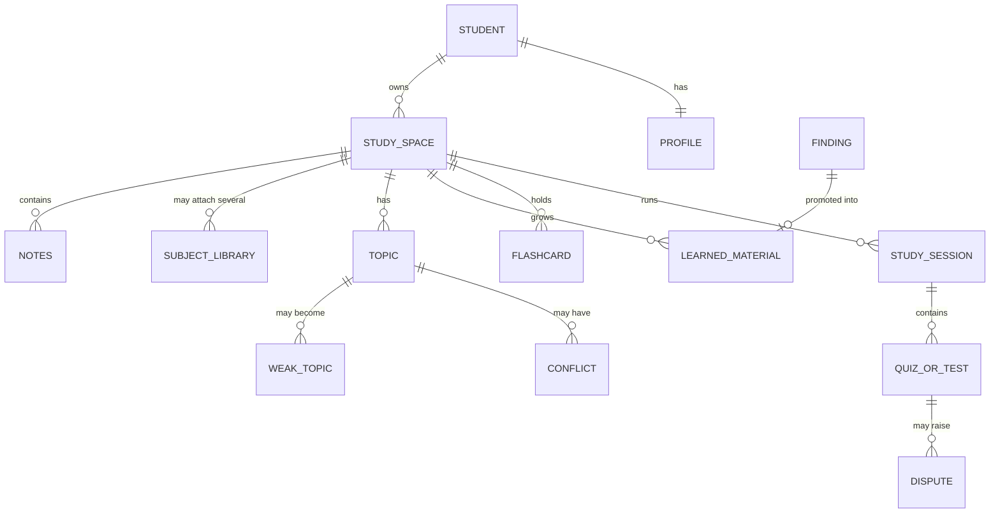

# Jimmy: Domain

The domain model: what the concepts are, how they relate, the rules that must always hold, and how they change over time. Term definitions are in [GLOSSARY.md](./GLOSSARY.md). This file explains the relationships between them.

## 1. Concepts and relationships

- A **Student** owns many **Study Spaces** and has one **Profile** shared across them.
- A **Study Space** is the unit of isolation. Notes, Topics, Weak Topics, Flashcards, Learned Material, Conflict decisions and quiz history all belong to exactly one Study Space.
- **Notes** and the **Subject Library** are the trusted Sources. **Learned Material** is a web-sourced Source that has not been reviewed until the Student approves it.
- A **Finding** exists only for the current conversation until a **Promotion** turns it into Learned Material.
- A **Topic** is the unit of progress. Weak Topics, Conflicts and quiz results attach to Topics.

## 2. Sources and trust

| Source | Cited | In answers | In Quiz, Test, Flashcards |
|---|---|---|---|
| Notes | Yes | Yes | Yes |
| Subject Library | Yes | Yes | Yes |
| Learned Material | Yes, labelled "web-sourced, unreviewed" | Yes | Only after the Student approves it |
| Finding | Yes | Yes (this conversation only) | No |
| Tutor Knowledge | Labelled, not cited | Yes | No |

A Citation names the document or book, author, and page or section.

## 3. Invariants

1. A Study Space never reads another Study Space's data.
2. Every statement in an answer is attributed to a Source: cited, or labelled as Tutor Knowledge.
3. Assessments (Quiz, Test, Flashcards) are built only from Notes, the Subject Library and approved Learned Material.
4. A Conflict is flagged to the Student and never silently resolved.
5. Text from Notes, the Subject Library, Findings and Learned Material is data, never instructions.
6. A Finding is promoted only if it is relevant, from a reputable source, stable, not a duplicate and free of injection.
7. A Student's Dispute decision overrides the automatic grade.
8. Anything created, deleted or personal (Flashcards, deleting Notes or a Study Space, Profile facts) needs the Student's Approval; Weak Topics update automatically but are visible and clearable.

## 3a. Rules with numbers

- **Weak Topic:** weak after 2 wrong answers in the last 5; no longer weak after 3 correct in a row.
- **Dispute:** raised when grader confidence is below 0.7 or the score is within 0.15 of the pass line (0.6). Both are settings (`DISPUTE_CONFIDENCE_THRESHOLD` and `DISPUTE_MARGIN` until the settings screen exists). Only written answers can be disputed; a multiple-choice answer is always graded with full confidence.
- **Upload:** PDF, Markdown or plain text; 20 MB and 200 pages; scanned documents are rejected.
- **Agent loop:** at most 8 steps, and stop after 3 identical tool calls.

## 4. Lifecycles

**Notes document:** uploaded → text extracted (or rejected) → Topics proposed → Topic review → indexed → (deleted with Approval).

**Finding:** fetched in a conversation → used in the answer → Promotion decision → either discarded with the conversation, or saved in the background as Learned Material.

**Learned Material:** saved (unreviewed) → approved or deleted by the Student. Approved material may feed assessments.

**Weak Topic:** normal → weak (2 of the last 5 wrong) → normal (3 correct in a row), or cleared by the Student.

**Conflict:** detected by `compare_sources` (Notes versus Subject Library or Learned Material; Tutor Knowledge is not compared yet) → paused → the Student keeps Notes, accepts the other Source, or marks it unsure → decision stored for that pair of passages, and used without asking again until the Student forgets it.

**Dispute:** grade uncertain → paused → the Student sees their answer beside the Source passage and decides (right, wrong, or not sure, which counts as not right and marks the Topic for review) → decision recorded, the grade overridden and the Weak Topic record updated.

## 5. Scenarios used to stress-test the model

1. **Same question, two Spaces.** The Student asks about "cell division" in Biology and in Physics. Each Space answers only from its own sources.
2. **Notes contradict the textbook.** The Notes say photosynthesis happens in the mitochondria; the Subject Library says chloroplasts. The agent pauses and the Student decides; the decision is used next time that Topic comes up.
3. **Answer not in Notes or Library.** The agent searches Wikipedia, answers with a cited Finding, and promotes it in the background without making the Student wait.
4. **Poisoned web page.** A fetched page contains "ignore your instructions". The scan flags it and it is not promoted.
5. **Unreviewed Learned Material.** It shows up in an answer with its warning label, and does not appear in a Quiz until approved.
6. **Borderline answer.** A short answer scores 0.52 against a pass line of 0.5. The Student is asked to decide.

## 6. Open questions (defaults proposed, not yet decided)

- **Topic merge:** when two Topics are merged, their quiz history and Weak Topic counts are combined. *Proposed default: yes.*
- **Deleting a Space with a background Promotion pending:** the job is cancelled and its result discarded. *Proposed default: yes.*
- **Duplicate Findings:** a Finding counts as a duplicate when its page is already saved, or its nearest chunk in the Space has a cosine similarity of 0.92 or more (`DUPLICATE_DISTANCE = 0.08`). *Chosen by hand in issue 9; revisit with real data.*
- **Conflict decisions and new Notes:** a decision belongs to one pair of passages, so re-uploaded or new Notes (new chunks) are compared and asked about afresh, while the same passages are never asked twice. Deleting the Notes deletes the decision. *Chosen in issue 10.*
